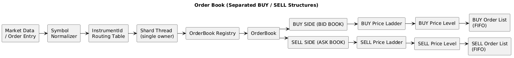

# Eigenbook

**A low-latency limit order book engine in modern C++23.**


Eigenbook is a single-writer-per-shard limit order book built for deterministic execution,
cache-efficient data access, and scalable multi-instrument trading. Each book is owned by exactly
one thread, so the matching path needs no locks.

> **Status:** active development. The order book (matching, cancel, modify, both price ladders)
> is complete and tested. The sharded engine around it (routing, thread-per-shard) is planned.
> See [Roadmap](#roadmap).

---

## Table of contents

- [Features](#features)
- [Requirements](#requirements)
- [Getting started](#getting-started)
- [Usage](#usage)
- [Testing](#testing)
- [Benchmarks](#benchmarks)
- [Design](#design)
- [Project structure](#project-structure)
- [Roadmap](#roadmap)
- [Contributing](#contributing)
- [License](#license)

---

## Features

- **Price-time priority matching** for limit and market orders, with partial fills and
  multi-level sweeps.
- **O(1) cancel and modify** through a flat open-addressing order index.
- **Two price-ladder strategies** behind one C++20 concept:
  - `OrderBook`: `std::map` ladder for sparse or unbounded prices.
  - `DenseOrderBook`: fixed array + two-level bitset for dense, bounded tick ranges.
- **No allocation while matching:** orders come from a pre-reserved object pool, and fills are
  reported through a callback.
- **Cache-aware layout:** each `Order` node is exactly one 64-byte cache line.
- **Strong types** for `Price`, `Quantity`, `OrderId`, `Timestamp`, `InstrumentId` and `ShardId`.
- **Errors as values:** rejections are returned as `std::expected<…, RejectReason>`, never thrown.
- **Verified against a reference model:** a randomized differential test runs both ladders against
  a naive reference book.

---

## Requirements

| Component | Minimum |
|---|---|
| Compiler | C++23: MSVC 19.38+ (VS 2022 17.8+), GCC 13+, or Clang 17+ |
| CMake | 3.20+ |
| Build tool | Ninja (recommended), Make, or Visual Studio |
| Git | Needed by CMake to download GoogleTest for the tests |

There are no third-party runtime dependencies. GoogleTest 1.15.2 is downloaded automatically when
tests are enabled.

The full system, functional and non-functional requirements, each linked to the tests that verify
it, are in **[docs/REQUIREMENTS.md](docs/REQUIREMENTS.md)**.

---

## Getting started

### 1. Install a toolchain

<details>
<summary><b>Windows</b></summary>

Install the Visual Studio 2022 Build Tools with the C++ workload. It includes MSVC, the Windows
SDK, CMake and Ninja:

```powershell
winget install Microsoft.VisualStudio.2022.BuildTools --override "--wait --passive --add Microsoft.VisualStudio.Workload.VCTools --includeRecommended"
```

Run the build commands below from **Developer PowerShell for VS 2022**, so that the compiler is on
`PATH`.
</details>

<details>
<summary><b>Linux (Debian / Ubuntu)</b></summary>

```bash
sudo apt install g++-13 cmake ninja-build git
export CXX=g++-13
```
</details>

### 2. Clone, build and run

```bash
git clone <repository-url> Eigenbook
cd Eigenbook

cmake -S . -B build -G Ninja -DCMAKE_BUILD_TYPE=Release
cmake --build build
```

Run the demo / benchmark application:

```bash
./build/app/TradingEngine_app          # Linux / macOS
.\build\app\TradingEngine_app.exe      # Windows
```

### CMake options

| Option | Default | Description |
|---|---|---|
| `CMAKE_BUILD_TYPE` | (empty) | `Debug`, `Release`, `RelWithDebInfo`. Use `Release` for benchmarks. |
| `BUILD_TESTING` | `ON` | Build the GoogleTest suite. Set `OFF` to skip it and the download. |

### VS Code

With the **CMake Tools** extension: select the kit *Visual Studio Build Tools 2022 Release -
amd64* (Windows) or your GCC/Clang kit (Linux). Then press **F7** to build and **Shift+F5** to
run `TradingEngine_app`.

---

## Usage

The library target is `TradingEngine`. Link it from your CMake project with
`target_link_libraries(my_app PRIVATE TradingEngine)`.

```cpp
#include <iostream>
#include <tradingengine/orderbook.h>

int main() {
    OrderBook book(InstrumentId{1});

    // A resting sell order: 100 lots at 10 050 ticks.
    if (!book.addOrder({.id = {1}, .side = OrderSide::SELL, .type = OrderType::LIMIT,
                        .price = {10'050}, .quantity = {100}})) {
        return 1;
    }

    // An aggressive buy: trades 40 lots against order 1, reported through the callback.
    const auto result = book.addOrder(
        {.id = {2}, .side = OrderSide::BUY, .type = OrderType::LIMIT,
         .price = {10'050}, .quantity = {40}},
        [](const Fill& f) {
            std::cout << "fill " << f.quantity.value << " @ " << f.price.value << '\n';
        });

    if (!result) {
        // result.error() is a RejectReason, e.g. DUPLICATE_ORDER_ID.
        return 1;
    }

    // Order 1 has 60 lots open; reducing it at the same price keeps its time priority.
    const auto modified = book.modifyOrder({.id = {1}, .price = {10'050}, .quantity = {30}});

    const auto cancelled = book.cancelOrder({1});
    if (modified && cancelled) {
        std::cout << "cancelled " << cancelled->value << " open lots\n"; // 30
    }
}
```

For a dense, bounded tick range, use `DenseOrderBook` and give it the range:

```cpp
DenseOrderBook book(InstrumentId{1}, {.minPrice = {9'000}, .tickCount = 2'048});
```

| Operation | Returns |
|---|---|
| `addOrder(request[, onFill])` | `std::expected<ExecutionResult, RejectReason>`, with filled / resting / cancelled quantities |
| `modifyOrder(request[, onFill])` | Same as `addOrder` |
| `cancelOrder(id)` | `std::expected<Quantity, RejectReason>`: the open quantity that was removed |
| `bestBid()`, `bestAsk()` | `std::optional<Price>` |
| `bids()`, `asks()` | The ladder for each side: `findLevel`, `forEachLevel`, `levelCount` |

---

## Testing

```bash
cmake -S . -B build -G Ninja -DCMAKE_BUILD_TYPE=Debug
cmake --build build
ctest --test-dir build --output-on-failure
```

The suite (94 tests) is organized by component:

| File | Covers |
|---|---|
| [tests/Types_tests.cpp](tests/Types_tests.cpp) | Strong types and the `Order` node |
| [tests/PriceLevel_tests.cpp](tests/PriceLevel_tests.cpp) | The intrusive FIFO queue at one price |
| [tests/PriceLadder_tests.cpp](tests/PriceLadder_tests.cpp) | Both ladder strategies, on both sides |
| [tests/OrderBook_tests.cpp](tests/OrderBook_tests.cpp) | Matching, cancel and modify, run on both book types |
| [tests/Util_tests.cpp](tests/Util_tests.cpp) | `LevelBitmap`, `OrderIndex`, `ObjectPool` |
| [tests/Differential_tests.cpp](tests/Differential_tests.cpp) | 20 000 random operations: map ladder vs dense ladder vs a reference model |

Each test is mapped to a requirement in [docs/REQUIREMENTS.md](docs/REQUIREMENTS.md).

---

## Benchmarks

`TradingEngine_app` replays 2 000 000 synthetic operations: about two thirds are limit orders
around a mid price and one third are cancels.

| Ladder | ns / op |
|---|---|
| `std::map` (`OrderBook`) | ~106 |
| array + bitset (`DenseOrderBook`) | ~90 |

*Release build, MSVC 19.44, Windows 11, Intel Core i7-13650HX, single thread. These are
indicative numbers from the demo application, not a controlled latency benchmark (no CPU
pinning, no percentiles). A proper benchmark harness is on the roadmap.*

---

## Design

### System flow



### Core principles

- **Shard ownership.** Each shard owns its order books and runs all mutations on a single thread,
  so there is no shared mutable state on the matching path.
- **Precomputed routing.** Symbols are resolved to stable `InstrumentId` values before the hot
  path. Routing is then a direct `InstrumentId → ShardId` lookup.
- **Book-local matching.** Each order book handles its own matching, sweeping, cancel and modify.
- **FIFO at each price.** Orders at one price are kept in arrival order in an intrusive doubly
  linked list.
- **Fast cancel and modify.** An order-id index points directly at each order node.

### Data structures

| Component | Structure | Purpose |
|---|---|---|
| Symbol registry | Hash map (cold path) | Symbol → `InstrumentId` |
| Routing table | Array / flat map | `InstrumentId` → `ShardId` |
| Shard registry | Hash map | `InstrumentId` → `OrderBook` |
| Order book | Single-owner object | Market state for one instrument |
| Price ladder | `std::map` *or* fixed array + two-level bitset | Price-level navigation |
| Price level | Intrusive doubly linked list | FIFO queue at one price |
| Order index | Open addressing, linear probing | `OrderId` → `Order*` |
| Order storage | Fixed-size object pool | Allocation-free order nodes |

### Matching model

Matching follows price-time priority:

1. Find the best price level on the opposite side.
2. Fill against its orders in FIFO order, at the maker's price.
3. Continue to the next level until the incoming order is filled, its limit is reached, or the book
   is empty.
4. Remove each price level as soon as it empties.
5. Rest the remainder of a limit order; cancel the remainder of a market order.

### Complexity

| Operation | Time | Notes |
|---|---|---|
| Symbol → `InstrumentId` | O(1) | Cold path only |
| Instrument → shard | O(1) | Direct lookup |
| Add order (no match) | O(1) dense / O(log P) map | P = price levels on that side |
| Cancel order | O(1) | Through the order index |
| Modify: reduce at same price | O(1) | Keeps time priority |
| Modify: price or size increase | Same as add | Loses time priority |
| Match / sweep | O(K + L) | K = fills, L = levels emptied |
| Best bid / ask | O(1) | Both ladders |

### Price ladder strategy

| | Fixed array + bitset | Balanced tree (`std::map`) |
|---|---|---|
| Best for | Dense, bounded tick ranges | Sparse or wide price spaces |
| Level access | O(1) | O(log P) |
| Memory | Proportional to tick range | Proportional to active levels |
| Out-of-range prices | Rejected (`PRICE_OUT_OF_RANGE`) | Accepted |

### Concurrency model

- One thread owns one shard; one shard owns many books.
- Each book is mutated by only one thread; there are no mutexes on the hot path.
- Concurrency is handled only at the boundaries: ingestion, routing and shard dispatch.

---

## Project structure

```
Eigenbook/
├── app/                      Demo and benchmark application
│   └── main.cpp
├── cmake/                    CMake package configuration template
├── docs/
│   └── REQUIREMENTS.md       Requirements and test traceability
├── include/tradingengine/    Public headers (header-only templates)
│   ├── types.h               Strong types: Price, Quantity, OrderId, ...
│   ├── order.h               Order node (one cache line)
│   ├── PriceLevel.h          FIFO queue at one price
│   ├── PriceLadder.h         Map and array+bitset ladders, PriceLadder concept
│   ├── OrderIndex.h          OrderId → Order* flat hash index
│   ├── orderbook.h           BasicOrderBook, OrderBook, DenseOrderBook
│   ├── TradingEngine.h       Engine (placeholder)
│   └── util/
│       ├── LevelBitmap.h     Two-level occupancy bitmap
│       └── ObjectPool.h      Fixed-size object pool
├── src/                      Library sources (explicit instantiations)
├── tests/                    GoogleTest suite
├── CMakeLists.txt
└── README.md
```

---

## Roadmap

- [x] **Core types:** `InstrumentId`, `ShardId`, `OrderId`, `Price`, `Order`, `OrderBook`
- [x] **Price ladders:** `std::map` and fixed array + bitset, O(1) best bid / ask
- [x] **Matching:** sweep, partial fills, price-time priority, removal of empty levels
- [x] **Order management:** order-id index, cancel, modify
- [x] **Optimization:** pool allocator, cache-line alignment
- [ ] **Routing:** symbol registry, instrument normalization, routing table, shard assignment
- [ ] **Shard engine:** thread per shard, shard-local registry, order dispatch queue
- [ ] **Optimization:** branchless inner loops, NUMA-aware placement
- [ ] **Benchmarking:** latency percentiles, CPU pinning, Google Benchmark harness
- [ ] **CI:** GitHub Actions on Linux (GCC, Clang) and Windows (MSVC), sanitizers

---

## Contributing

1. Create a branch from `main`.
2. Format the code with the project's [.clang-format](.clang-format) (`clang-format -i <files>`).
3. Add or update tests, and the matching entry in [docs/REQUIREMENTS.md](docs/REQUIREMENTS.md).
4. Make sure `ctest --test-dir build --output-on-failure` passes in both Debug and Release.
5. Open a pull request that describes the change and its motivation.

---

## License

No license has been chosen yet, so all rights are reserved by the author. Add a `LICENSE` file
(for example MIT or Apache-2.0) before distributing or accepting outside contributions.

---

## Acknowledgments

Built on standard low-latency systems techniques: sharding, ownership isolation, intrusive data
structures and cache-aware design.
