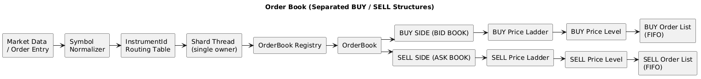

# Architecture

This document describes what exists today (the order book) and, separately, the target
architecture around it. Anything not yet implemented is marked **planned**.

## Target architecture

Only the right-hand part exists today: `OrderBook` → bid / ask side → price ladder → price level
→ FIFO order list. Symbol normalisation, the routing table, shard threads and the order-book
registry are **planned** (Phase B10). The planned engine follows the sequenced
state-machine pattern: every input is sequenced once, and each book is a deterministic state
machine over that log (Phase B3).

### Principles

- **Single owner per book.** A book is mutated by exactly one thread and has no internal
  locking. Concurrency is handled only at the boundaries (ingestion, sequencing, publication).
- **Pre-resolved identifiers.** Symbols are resolved to stable `InstrumentId` values off the hot
  path (planned); the book only sees ids.
- **Book-local matching.** Each book does its own matching, cancel and modify.
- **No allocation, locks, exceptions or I/O on the hot path** after warm-up. This is not fully
  true yet: see [Known limitations](../README.md#known-limitations).

## The order book

`BasicOrderBook<Ladder>` (`include/eigenbook/book/order_book.hpp`) owns:

| Component | Structure | File |
|---|---|---|
| Order storage | Fixed-size object pool with an intrusive free list; chunks of up to 4096 slots | `util/object_pool.hpp` |
| Order node | `Order`, exactly 64 bytes, `alignas(64)`; also the intrusive list node | `core/order.hpp` |
| Order index | `OrderId → Order*`, open addressing, linear probing, power-of-two table, load ≤ 1/2, backward-shift deletion, splitmix64 finalizer as hash | `book/locator/hash_order_index.hpp` |
| Price level | Intrusive doubly linked FIFO list plus aggregate quantity and count | `book/price_level.hpp` |
| Price ladder (sparse) | `std::pmr::map<Price, PriceLevel>` over an `unsynchronized_pool_resource` | `book/ladder/map_ladder.hpp` |
| Price ladder (dense) | One preallocated `PriceLevel` per tick + two-level occupancy bitmap + cached best index | `book/ladder/dense_ladder.hpp`, `util/level_bitmap.hpp` |

Both ladders satisfy the `PriceLadder` concept (`book/price_ladder.hpp`), so the book is one
template over the ladder. `OrderBook = BasicOrderBook<MapPriceLadder>`,
`DenseOrderBook = BasicOrderBook<ArrayPriceLadder>`.

### Order node layout

| Offset | Field | Size |
|---|---|---|
| 0 | `prev` | 8 |
| 8 | `next` | 8 |
| 16 | `level` | 8 |
| 24 | `id` | 8 |
| 32 | `price` | 8 |
| 40 | `quantity` | 8 |
| 48 | `timestamp` | 8 |
| 56 | `side` | 1 |
| 57 | `type` | 1 |
| 58–63 | free | 6 |

The links used while walking a queue and the fields read while matching share one cache line.

### Matching model

1. Find the best level on the opposite side.
2. Fill against its orders in FIFO order, at the maker's price; one `Fill` callback per
   execution.
3. Continue with the next level until the incoming order is filled, its limit is reached, or the
   opposite side is empty.
4. Remove each level as soon as it empties.
5. Rest the remainder of a limit order; cancel the remainder of a market order.

Modify: same price and quantity not larger → reduce in place, time priority kept. Anything else
→ remove and re-enter as a new limit order (it may trade, and it goes to the back of its level).

### Complexity

P = number of non-empty levels on one side, K = fills, L = levels emptied by a sweep,
T = ticks between the old best and the next non-empty level (dense ladder).

| Operation | Map ladder | Dense ladder |
|---|---|---|
| Best bid / ask | O(1) | O(1) (cached index) |
| Rest a limit order | O(log P) (`try_emplace` searches even when the level exists) | O(1) |
| Order lookup by id (cancel, modify) | Expected O(1); worst case is the length of the probe cluster | same |
| Cancel, level stays non-empty | Lookup + O(1) unlink | same |
| Cancel that empties a level | + O(log P) erase (O(1) amortised if it is the best level) | + O(1), or, if it was the best level, a bitmap scan of O(1 + T/4096) words (one summary word covers 4096 ticks) |
| Modify: reduce at same price | Lookup + O(1) | same |
| Modify: price change or increase | Cancel + add | same |
| Sweep | O(K + L), each emptied best level erased in O(1) amortised | O(K + L) plus one bitmap scan per emptied level |

The map ladder's header comment currently states that adding at an existing price is O(1)
amortised; it is O(log P). It is corrected when the map ladder is reworked in Phase A3.

### Price ladder choice

| | Dense (array + bitmap) | Map |
|---|---|---|
| Best for | Dense, bounded tick ranges | Sparse or unbounded prices |
| Memory | Proportional to the tick range | Proportional to the number of live levels |
| Out-of-range prices | Rejected (`PRICE_OUT_OF_RANGE`) | Accepted |

A hybrid ladder (dense window around the touch, sparse overflow) is planned in Phase A3.

## Build structure

- `Eigenbook::book`: header-only `INTERFACE` target with a `FILE_SET HEADERS`
  ([ADR 0001](adr/0001-header-only-book-target.md)).
- `Eigenbook::eigenbook`: umbrella over all public libraries.
- `Eigenbook::platform`: the only compiled library (namespace `eigenbook::platform`): TSC
  reads and calibration, CPUID, thread pinning and priority, OS facts. Portable parts in
  `src/platform/`, OS parts in `src/platform/windows/` and `src/platform/linux/`. Used by the
  benchmarks now and by the engine later; the book itself does not depend on it.
- `bench/` (not installed): latency harness and seeded workloads, see
  [BENCHMARKS.md](BENCHMARKS.md).
- File layout and naming: [ADR 0002](adr/0002-file-layout-and-naming.md).
