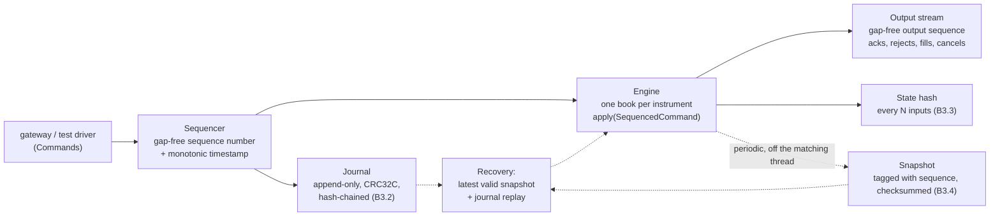

# Phase B3: sequencer, journal, snapshots, deterministic replay

Goal: every input is sequenced exactly once, and the books are a deterministic state machine over
that sequence. Then the state can be rebuilt from a snapshot plus a replay of the journal, and a
replay can be proved identical to the original run (same state hashes, byte-identical output).

This is the pattern behind LMAX, Nasdaq INET and Pillar-class engines: a sequencer gives every
input a gap-free number and the only timestamp the engine sees; journaling (and later
replication) happen on the sequenced stream before business logic consumes it; recovery is
snapshot + journal replay.

## Target architecture

Everything the engine reacts to is a sequenced input: orders, cancels, modifies, halts and
resumes now; configuration changes, phase transitions and timer ticks as later phases add them.
The engine never reads a clock of its own.

## Steps

### B3.1 Sequenced commands and the deterministic engine core

- `Command`: one fixed-layout, trivially copyable record per input (new order, cancel, modify,
  halt, resume). Fixed size and static-asserted offsets, because B3.2 journals it byte for byte.
- `Sequencer<Clock>`: gap-free sequence numbers from 1; a timestamp from an injected clock, made
  monotonic (a clock that steps back is clamped to the last issued time). `ManualClock` for tests
  and replay; a steady clock for live use.
- `Engine<Book>`: books registered per instrument on the cold path; `apply(SequencedCommand,
  sink)` on the hot path. It accepts only the next sequence number (a gap or a repeat is refused
  and changes nothing); it never throws for business outcomes; it emits typed output events to
  a sink (template, no virtual call): accepted (with filled / resting / cancelled quantities),
  rejected (with the reason), fill, cancelled, modified, halted, resumed. Output events carry a
  gap-free output sequence and the input sequence that caused them.
- Determinism: the same command log gives a byte-identical output stream on a fresh engine, and
  the same output on every book type.
- Closes two deferrals of B1.2: the participant `CancelRequest` (now the cancel command) and the
  per-book output sequence (now the engine's output sequence, which also numbers cancels).

### B3.2 Journal

Append-only file of fixed-layout little-endian records: header (magic, schema version, build id,
configuration hash), then one record per sequenced command (length, sequence, payload,
CRC32C, hash of the previous record: a hash chain for tamper evidence). Configurable fsync policy
(never, every N records, every record). On open: torn-tail detection and safe truncation to the
last complete, valid record. File I/O and fsync in the platform module.

### B3.3 State hash

An incrementally maintained hash of every book's state, updated in O(1) per change, emitted as an
output event every N sequence numbers. Replay must reproduce every hash.

### B3.4 Snapshots and recovery

Periodic snapshot tagged with the sequence number it reflects, checksummed, written off the
matching thread. Recovery = latest valid snapshot + journal replay from the next sequence number.
The journal header's build id and configuration hash must match the running engine, or replay
refuses unless forced (the Knight Capital 2012 lesson: mixed code and reused flags across
servers). Measured: replay rate and recovery time for 10 million messages.

## Outcome of B3.1

As built (ADR 0007):

- `engine/command.hpp` (`Command` 64 bytes, `SequencedCommand` 80 bytes),
  `engine/sequencer.hpp` (`Sequencer<Clock>`, `ManualClock`, `SteadyClock`),
  `engine/output_event.hpp` (`OutputEvent` 96 bytes), `engine/engine.hpp` (`Engine<Book>`).
  All in the header-only `Eigenbook::book` target.
- New reject reasons `UNKNOWN_INSTRUMENT`, `INVALID_COMMAND`. Requirements FR-60 to FR-64,
  NFR-24.
- Determinism: 20,000 seeded inputs over three instruments give 23,491 events (3,491 fills,
  6,355 accepted, 250 modified, 331 cancelled, 12,629 rejected, 196 halted, 239 resumed), with a
  byte-identical stream on a second engine and on map M0, map M2, dense and hybrid books. Most
  rejects come from orders sent to a halted instrument before the next resume, and from cancels
  and modifies addressed at random ids.
- A first version of the test's command log addressed cancels at a random id, instrument and
  participant, and only 12 of them hit a resting order of their owner. The coverage check in
  the test caught it; the log now addresses four in five cancels and modifies at a real order,
  as its owner.

Not done in B3.1: books with engine-issued handles need a gateway step to reserve the handle
before the `NEW_ORDER` command exists (noted in ADR 0007); latency of `apply` against a direct
book call has not been measured.

## Requirements

New IDs FR-60 onwards (FR-50..53 are the planned sharding requirements of B10).

## Risks

- Determinism leaks: anything that depends on addresses, hash-table iteration order, wall-clock
  time or uninitialised padding breaks byte-identical replay. The output events and commands are
  value types with explicitly zeroed padding; the engine never iterates a hash table to produce
  output.
- Fixed record layout ties the journal to the struct layout: every change of `Command` is a schema
  version change (B3.2 records the version and refuses a mismatch).
- Throughput of the journal (fsync) is a latency question for later phases; B3 measures it, it
  does not tune it.
