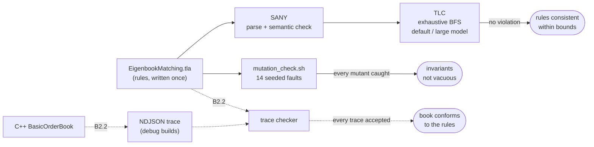
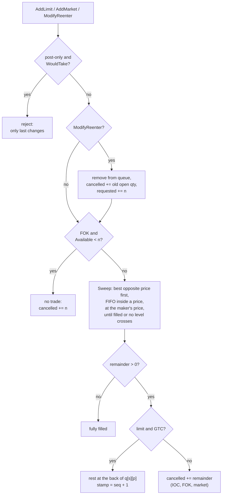
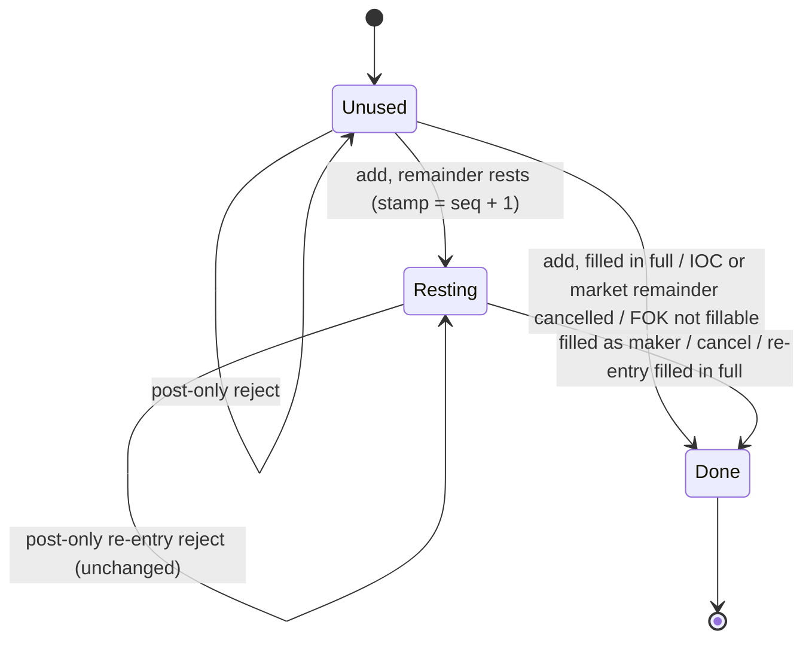

# Formal model of matching

This directory holds the TLA+ specification of the matching rules of one Eigenbook book (Phase
B2), the TLC models that check it, and the mutation check that shows every invariant can fail.
Decision record: [ADR 0005](../docs/adr/0005-formal-model-of-matching.md). Plan:
[docs/plans/PHASE-B2.md](../docs/plans/PHASE-B2.md).

| File | Purpose |
|---|---|
| [tla/EigenbookMatching.tla](tla/EigenbookMatching.tla) | specification: state, actions, matching, invariants |
| [tla/EigenbookMatching.cfg](tla/EigenbookMatching.cfg) | default model (2 prices, 3 ids, quantity ≤ 2) |
| [tla/EigenbookMatching_large.cfg](tla/EigenbookMatching_large.cfg) | large model (3 prices, 3 ids, quantity ≤ 2) |
| [tla/mutation_check.sh](tla/mutation_check.sh) | vacuity check: one seeded fault per invariant, each must be caught |

## Status

| Step | State |
|---|---|
| B2.1 specification, parsed (SANY) | done |
| B2.1 default model checked (TLC) | done: no violation, 4,886,533 distinct states |
| B2.1 every invariant falsifiable | done: 14 of 14 mutants caught |
| B2.1 large model checked (TLC) | done: no violation, 64,807,213 distinct states |
| B2.2 trace validation of the C++ book | not started |

What a passing run means: within the bounds, every reachable state satisfies every invariant, so
the rules as written are consistent with each other. It does **not** yet mean that the C++ book
follows them; that is what B2.2 (trace validation) checks.

## Verification pipeline



Solid edges exist today; dashed edges are Phase B2.2.

## The model

### State

| Variable | Meaning | C++ counterpart (`BasicOrderBook`) |
|---|---|---|
| `q[s][p]` | ids resting on side `s` at price `p`, in time priority | the `PriceLevel` at `p` in the side-`s` ladder: `front()`, then `nextInLevel()` |
| `ord[i]` | resting order `i`: side, price, open quantity, stamp, time in force, post-only; `NoOrder` if not resting | `findOrder(i)`: `getSide()`, `getPrice()`, `getQuantity()`, `getTimestamp()`, `getTimeInForce()`, `isPostOnly()`; `nullptr` ↔ `NoOrder` |
| `seq` | priority sequence: stamp of the newest order that rested or re-entered | the book's `prioritySequence` (the largest `getTimestamp()` ever issued) |
| `used` | ids accepted so far (ids are not reused in the model) | none: modelling choice |
| `requested`, `filled`, `cancelled` | ghosts: quantity accounting per id | none: follow from the requests and their `ExecutionResult`s and `Fill`s |
| `reqType` | ghost: `"LIMIT"` / `"MARKET"` per id | none: from the request |
| `volume` | ghost: total quantity traded so far | the sum of `Fill::quantity` over all calls |
| `last` | the last action, its parameters and its trades | the last call and the `Fill`s it reported, in order |

This table is the abstraction function from C++ state to specification state that B2.2's trace
checker implements.

### Actions

| Action | C++ call | Enabled when |
|---|---|---|
| `AddLimit(i, s, p, n, tif, po)` | `addOrder` (LIMIT) | `i` unused; `seq < MaxSeq`; post-only only with GTC |
| `AddMarket(i, s, n, tif)` | `addOrder` (MARKET), tif ∈ {IOC, FOK} | `i` unused |
| `Cancel(i)` | `cancelOrder(i)` | `i` resting |
| `ModifyReduce(i, n)` | `modifyOrder`, same price, `n ≤` open | `i` resting |
| `ModifyReenter(i, p, n)` | `modifyOrder`, new price or `n >` open | `i` resting; `seq < MaxSeq` |

A post-only add or re-entry that would trade is a reject: only `last` changes, as in the book
(`POST_ONLY_WOULD_TRADE`, nothing mutated).

### How one request is processed



The order of these decisions is the book's: `validateNew` (post-only after the price checks),
then `execute` (the FOK gate from a read-only look, then the sweep, then rest or cancel).

### Life of one order id



In the C++ book `Done` ids may be reused (FR-05); in the model they are not, which keeps the
state space finite without changing any matching rule.

### Abstractions

| Left out or simplified | Why the matching rules do not change |
|---|---|
| id reuse | a reused id starts a new, independent life; nothing in matching depends on the id value |
| DAY vs GTC | identical until sessions exist (B4/B8) |
| general minimum quantity | the same read-only gate as FOK, which is its full-quantity case |
| MARKET with DAY / GTC | the book treats it as IOC (B1.3) |
| limits, capacity, participants, halts | reject before any mutation; they decide whether matching starts, not how it goes |
| ladders, locators, pools | representation; all ladders and locators produce identical fills (FR-41, differential tests) |

## Invariants

| Invariant | Rule | Requirement | Mutant that breaks it |
|---|---|---|---|
| `TypeOK` | variables stay in their types and bounds | | `stamp-overflow` |
| `QueueConsistent` | every queued id rests at that side and price, once; every resting order is queued | NFR-20 | `filled-maker-stays-q` |
| `NoEmptyLevel` | a level holds only open orders: a filled maker leaves at once | FR-16 | `filled-maker-stays` |
| `NoCross` | best bid < best ask | FR-19 | `limit-never-matches` |
| `QuantityConservation` | requested = filled + resting + cancelled, per id | FR-18 | `cancel-loses-qty` |
| `PriorityStampsIncrease` | FIFO order is priority order | FR-10, FR-34 | `constant-stamp` |
| `PriceTimePriority` | no resting maker was ahead of one that traded; one request's trades follow priority | FR-10 | `lifo-queue` |
| `MakerPrice` | every trade is at the maker's price | FR-11 | `maker-price` |
| `NoTradeThroughLimit` | a limit taker never trades beyond its limit | FR-12 | `trade-through` |
| `MarketNeverRests` | only limit orders with a resting time in force rest | FR-14, FR-37 | `ioc-rests` |
| `ModifyPriorityRule` | reduce keeps stamp and position; a re-entry that rests is newest, at the back | FR-23, FR-24 | `reduce-restamps` |
| `FokAllOrNothing` | a FOK trades its whole quantity or nothing | FR-37 | `no-fok-gate` |
| `PostOnlyNeverTakes` | a post-only order, or its re-entry, never trades on arrival | FR-39 | `no-post-only-check` |
| `FilledMatchesTrades` | fills come only from trades: the fills of all ids add up to twice the traded volume | FR-17, FR-18 | `fill-without-trade` |

## Running

Requirements: Java 11 or later and `tla2tools.jar` from the TLA+ tools release
[v1.7.4](https://github.com/tlaplus/tlaplus/releases/tag/v1.7.4). The jar is not in the repository
(ADR 0005); keep it under the ignored `build/tools/`.

```bash
mkdir -p build/tools
curl -L -o build/tools/tla2tools-1.7.4.jar \
     https://github.com/tlaplus/tlaplus/releases/download/v1.7.4/tla2tools.jar
sha256sum build/tools/tla2tools-1.7.4.jar     # compare with the table below

cd formal/tla                                  # TLC resolves modules from the working directory
java -cp ../../build/tools/tla2tools-1.7.4.jar tla2sany.SANY EigenbookMatching.tla
java -XX:+UseParallelGC -cp ../../build/tools/tla2tools-1.7.4.jar tlc2.TLC \
     -metadir ../../build/tlc/states -workers auto \
     -config EigenbookMatching.cfg EigenbookMatching.tla

cd ../..
formal/tla/mutation_check.sh                   # exit status 0 = every mutant caught
```

| File | Version | SHA-256 |
|---|---|---|
| `tla2tools.jar` | v1.7.4 (TLC2 2.19, rev 5a47802) | `936a262061c914694dfd669a543be24573c45d5aa0ff20a8b96b23d01e050e88` |

The release page publishes no checksum for v1.7.4, so this hash is the one of the copy used for
the runs below (trust on first use), not a verified signature.

## Recorded runs

Environment for every run: Intel i7-13650HX (14 cores, 20 logical CPUs), Windows 11 10.0.26200,
Java 25.0.1 (Oracle), TLC2 2.19 (v1.7.4), `-XX:+UseParallelGC`, default heap (5,397 MB),
`-workers auto` (20), breadth-first search. No other heavy process was running unless stated.

| Date | Model | Bounds (prices, ids, max qty, MaxSeq, TIFs) | Result | Generated | Distinct | Depth | Runtime |
|---|---|---|---|---|---|---|---|
| 2026-11-15 | default | {1,2}, {1,2,3}, 2, 4, {GTC, IOC, FOK} | no violation (14 invariants) | 34,694,113 | 4,886,533 | 11 | 3 min 20 s |
| 2026-11-15 | large | {1,2,3}, {1,2,3}, 2, 5, {GTC, IOC, FOK} | no violation (14 invariants) | 610,216,297 | 64,807,213 | 13 | 35 min 03 s |

TLC stores state fingerprints, not states, so two different states with the same 64-bit
fingerprint would make it skip one of them. Its estimates of the probability that this happened:

| Model | Calculated (optimistic) | From the actual fingerprints |
|---|---|---|
| default | 7.9 × 10⁻⁶ | 1.3 × 10⁻⁶ |
| large | 1.9 × 10⁻³ | 1.1 × 10⁻⁴ |

The large model's estimate is no longer negligible: there is a small chance that some states
were not explored. A second run with a different fingerprint function (`-fp <n>`) that reaches
the same counts would make a missed state much less likely; it has not been done.

Earlier runs of the default model, on the specification before `volume` and
`FilledMatchesTrades` were added, found the same 34,694,113 / 4,886,533 states: once with 4
workers while a build matrix loaded the machine (7 min 03 s), once quiet with 20 workers
(4 min 10 s). The ghost adds no distinct states, as expected: in a correct model it is a function
of `filled`. Those runtimes are superseded by the rows above. A first attempt at the large model,
on the earlier specification, was stopped after 2 minutes when the specification changed.

### Bounds not yet checked

The plan names up to 4 ids and quantity ≤ 3. Neither has been run: 3 prices with 3 ids already
take 35 minutes and 65 million states, and each extra id or quantity value multiplies that.
Candidates, in order: 4 ids with 2 prices; quantity ≤ 3 with 2 prices; symmetry reduction over
ids (the ids are interchangeable, but TLC's symmetry needs them as model values, which the
specification's integer defaults in `last` would have to accommodate).

### Mutation check (2026-11-15)

Model: prices {1,2}, ids {1,2,3}, quantity ≤ 2, `MaxSeq` 4; each mutant checks only its own
invariant. Runtime for all 14: about 25 s. With several workers TLC may report a different
counterexample of the same or similar length from run to run (two runs swapped 3 and 4 states for
the two `filled-maker-stays` mutants); "caught" is the result that matters.

| Mutant | Fault injected | Invariant | Result |
|---|---|---|---|
| `maker-price` | a limit taker trades at its own limit, not the maker's price | `MakerPrice` | caught, 3-state counterexample |
| `lifo-queue` | the sweep takes the newest order of a level first | `PriceTimePriority` | caught, 4 states |
| `no-fok-gate` | FOK skips the liquidity check | `FokAllOrNothing` | caught, 3 states |
| `no-post-only-check` | post-only add is not checked | `PostOnlyNeverTakes` | caught, 4 states |
| `ioc-rests` | an IOC remainder rests | `MarketNeverRests` | caught, 4 states |
| `reduce-restamps` | reduce gives the order a new stamp | `ModifyPriorityRule` | caught, 4 states |
| `limit-never-matches` | limit orders never sweep | `NoCross` | caught, 4 states |
| `cancel-loses-qty` | cancel does not account the open quantity | `QuantityConservation` | caught, 4 states |
| `trade-through` | the sweep ignores the limit price | `NoTradeThroughLimit` | caught, 4 states |
| `filled-maker-stays` | a filled maker stays in its queue | `NoEmptyLevel` | caught, 4 states |
| `filled-maker-stays-q` | the same fault | `QueueConsistent` | caught, 3 states |
| `constant-stamp` | every resting order gets stamp 1 | `PriorityStampsIncrease` | caught, 3 states |
| `fill-without-trade` | a limit order is reported filled without trading (zero quantity passed to the sweep) | `FilledMatchesTrades` | caught, 2 states |
| `stamp-overflow` | the `MaxSeq` guard is off by one | `TypeOK` | caught, 6 states |

How `fill-without-trade` came about: the first version of the script used that fault to disable
matching, aiming at `NoCross`. It was not caught. Every limit order counted as filled, so nothing
rested and the book could never cross, and no invariant then said that fills must come from
trades. Two changes followed: the `NoCross` mutant became `limit-never-matches` (caught), and the
specification gained the ghost `volume` and the invariant `FilledMatchesTrades`, which catches the
original fault. The mutation check found a gap in the specification, which is what it is for.
